<div align="center">


# Planify

**Dalla prima idea alla tavola tecnica: progetta la casa in pianta, in 3D e in render, nel browser.**

Genera planimetrie complete di muri, porte, finestre e arredi, o disegnale a mano.
Poi modificale, guardale in 3D, rendile fotorealistiche, aggiungi impianti, giardino e scala esterna ed esporta le tavole in scala.

[](https://planify-easy.vercel.app)


[Galleria](#galleria) ·
[Funzioni](#funzioni) ·
[Come funziona](#come-funziona) ·
[Avvio rapido](#avvio-rapido) ·
[Test](#test) ·
[Documentazione](#documentazione)

<br />

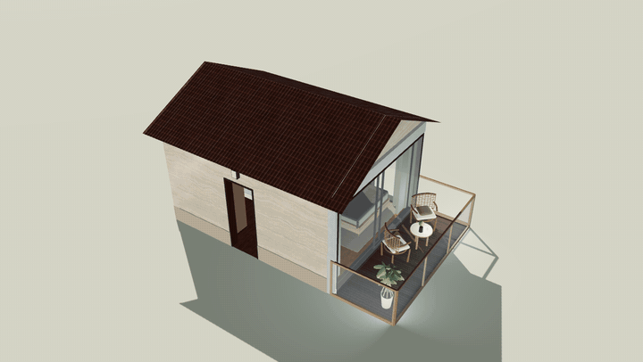

<sub>Un monolocale importato da un DXF: pianta, 3D e render escono dallo stesso progetto. <a href="docs/media/giro-3d.mp4">Guarda il video</a></sub>

</div>

---

## 💡 Cos'è Planify

Planify è un'applicazione web per progettare un edificio in modo rapido ma preciso. Il progetto nasce da un **motore in Python** che calcola layout, muri, aperture e arredi, e da un'**interfaccia React** che li mostra in pianta tecnica, in 3D navigabile e in render, e li lascia modificare con il mouse.

Puoi partire da quattro strade e passare dall'una all'altra:

| Parti da… | Cosa succede |
|---|---|
| 🎲 **Pochi parametri** | Dimensioni, numero di locali, stile e forma: il motore genera più varianti e sceglie la migliore. |
| ✏️ **Un disegno a mano** | Stanze a rettangolo o a forma libera (tonde, oblique…), con muri, porte e finestre calcolati. |
| 📥 **Un file** | DXF di studio, PDF esportato da un CAD o planimetria catastale scansionata. |
| 🏠 **Un progetto già fatto** | Aprilo da un link di sola lettura o dal cloud e continua da lì. |

---

<a id="galleria"></a>

## 🖼️ Galleria

<table>
  <tr>
    <td width="50%">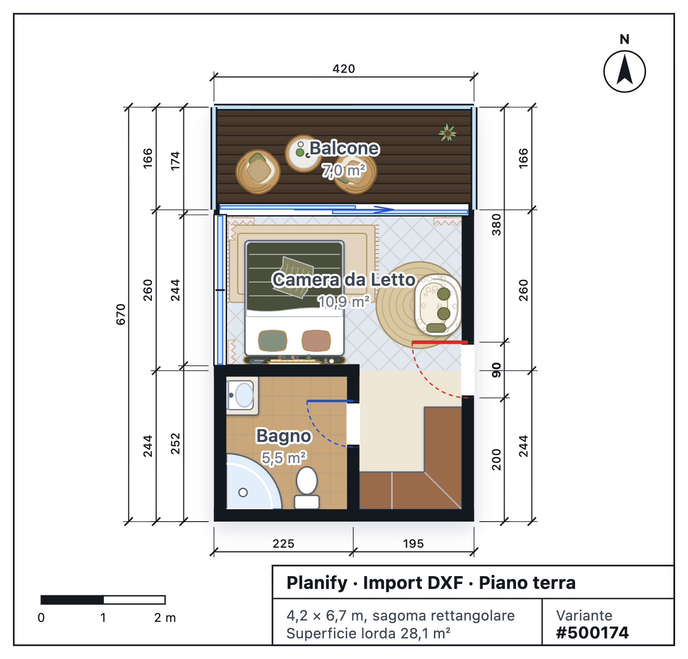<br /><sub><b>Pianta quotata</b> · arredata, con misure, nord, scala grafica e cartiglio.</sub></td>
    <td width="50%">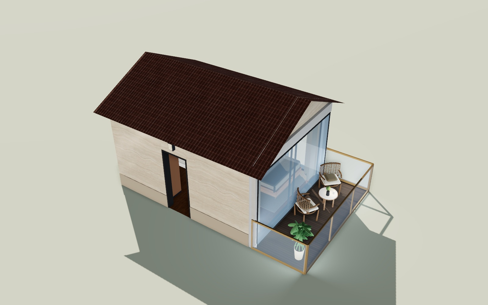<br /><sub><b>Render a tre quarti</b> · tetto, materiali veri, ombre e luce naturale.</sub></td>
  </tr>
  <tr>
    <td width="50%">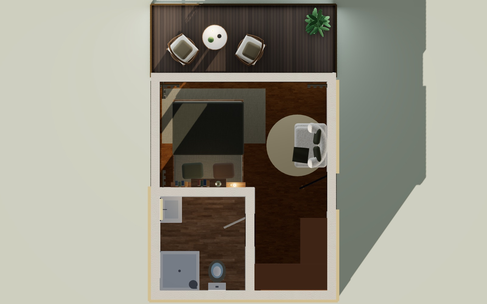<br /><sub><b>Pianta 3D dall'alto</b> · come una planimetria, ma con luce, ombre e arredi in volume.</sub></td>
    <td width="50%">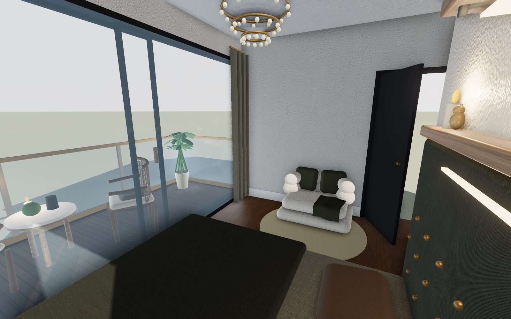<br /><sub><b>Render interno</b> · inquadrature automatiche a 1,6 m dentro ogni locale.</sub></td>
  </tr>
</table>

---

<a id="funzioni"></a>

## ✨ Cosa sa fare

### 🎲 Genera la pianta

- **Tipologie:** appartamento, loft con soppalco, ufficio, camera d'albergo, garage, giardino e case a più piani.
- **Sagome:** rettangolare, a **L, U, T**, scalare, e facciate curve.
- **Progettata come da un interior designer:** il motore prova più schemi e sceglie quello col punteggio migliore (luce naturale, circolazione, privacy, proporzioni, arredo completo) e mostra punti di forza e cosa migliorare.
- **Arredo sensato:** ogni mobile rispetta ingombri e porte, tiene conto delle finestre, e ci sono **mensole, vasi, libri e cornici** al posto giusto.
- **Vetrate panoramiche** a tutta altezza dove c'è muro libero e **vetrate scorrevoli** verso il balcone.
- **Seed:** blocchi la variante che ti piace o ne generi infinite a parità di misure.

### ✏️ Disegna a mano e modifica in diretta

<table>
  <tr>
    <td width="50%">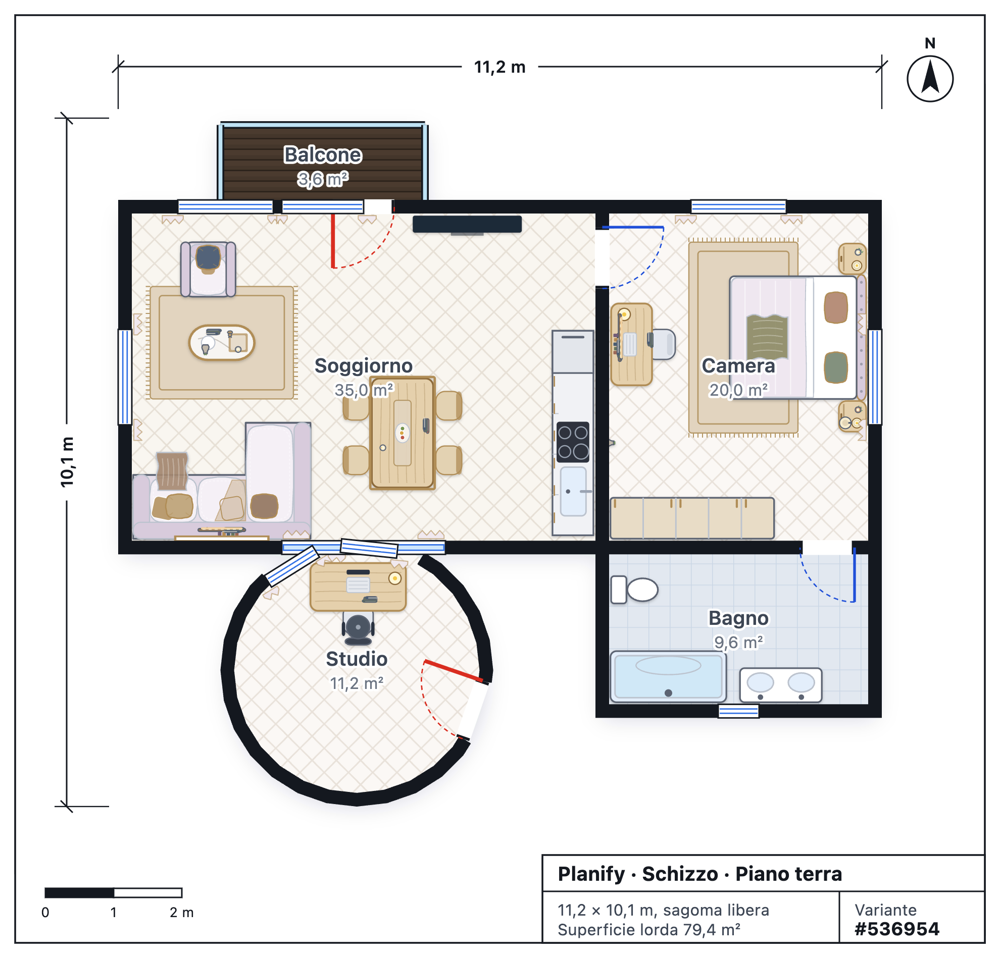</td>
    <td width="50%">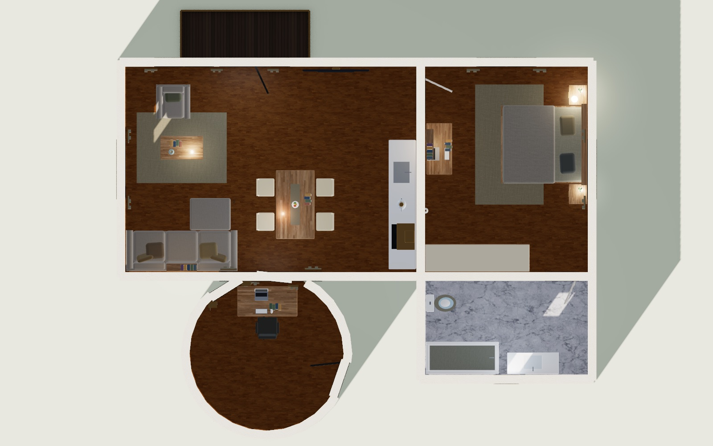</td>
  </tr>
</table>

Il disegno a mano non è una scorciatoia: **la pianta resta modificabile**.

- Trascini **vertici e lati** e il locale cambia forma; i locali vicini seguono il muro in comune e le porte restano attaccate.
- Sposti **un locale intero** con i suoi arredi.
- Aggiungi **porte, finestre, vetrate panoramiche, vetrate scorrevoli e balconi** cliccando sul muro, e le trasformi poi dal pannello (tipo, larghezza, verso).
- Disegni **più piani a mano**: quello vicino compare come guida tratteggiata e puoi partire dai suoi locali.
- Un contorno che si incrocia viene rifiutato, e tutto si annulla con Ctrl/Cmd+Z.

### 🏠 Casa su più piani, giardino e scala esterna

<div align="center">
  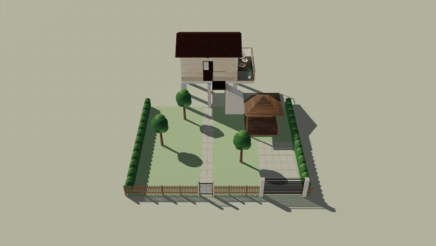<br />
  <sub>Casa al primo piano su pilastri, scala esterna che scende nel giardino. <a href="docs/media/giro-casa-giardino.mp4">Guarda il video</a></sub>
</div>

<br />

<table>
  <tr>
    <td width="50%">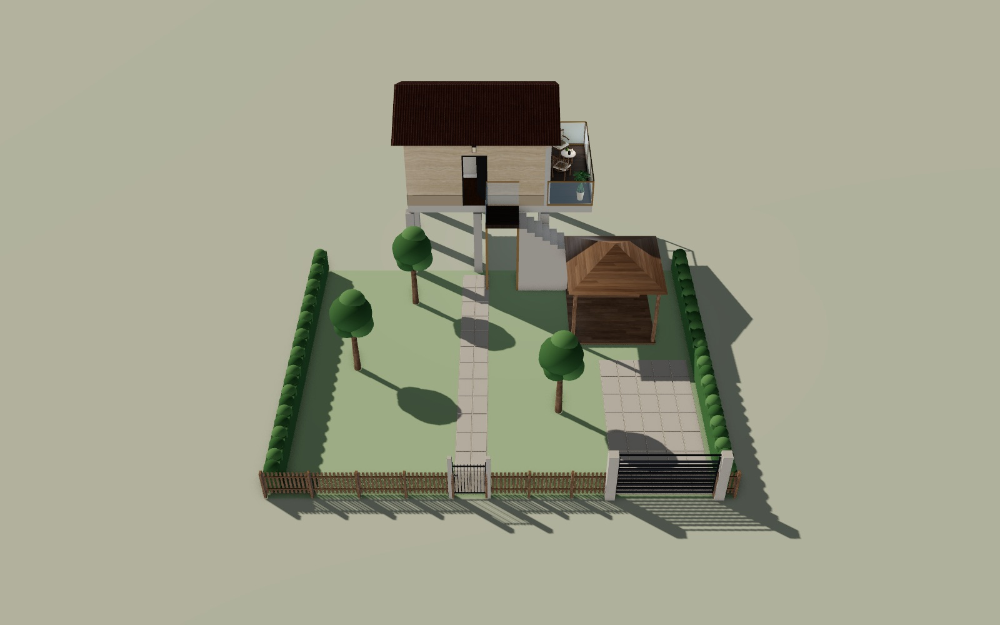</td>
    <td width="50%">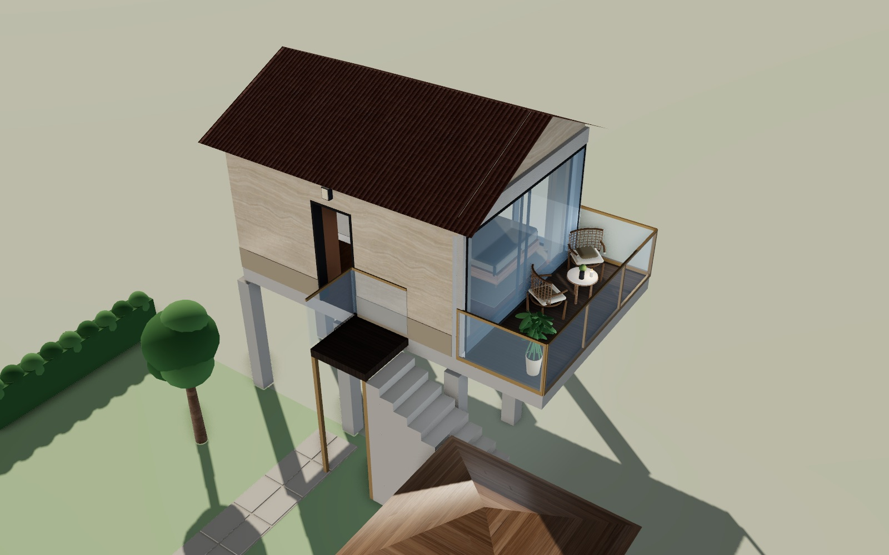</td>
  </tr>
</table>

- **Livello del piano** cambiabile in un clic: la casa può stare al primo piano sopra il giardino.
- **Scala esterna al giardino** con pianerottolo davanti alla porta, rampa verso il giardino o lungo la facciata, larghezza e dislivello regolabili.
- **Sostegno sotto la casa rialzata:** pilastri, basamento pieno o niente.
- **Il giardino segue la scala** e si sposta come vuoi (lungo la facciata, in distanza e in quota) con scatto a 25 cm e aggancio a centro casa, bordi, scala e portoncino; **cancello carrabile, cancellino e camminamento** si spostano a parte.
- Garage interrato con rampa, **balconi** con parapetto di vetro e terrazzi.

### 🧊 3D, render e video

- **3D navigabile** in tempo reale con **tetto acceso o spento**, muri bassi, vista esplosa, sezioni e livelli del loft.
- **Render fotorealistico** con luce del giorno, tramonto o notte; sfondo bianco, cielo o contesto; inquadrature automatiche (tre quarti, fronte dal lato del portoncino, pianta dall'alto, interni e giardino).
- **Tour 360°** per ogni locale e video del giro della casa; **path tracing** per le immagini più curate.
- **Materiali veri** (texture PBR CC0): facciata, tetto, pareti e pavimenti a scelta, **struttura in legno** con pilastri, travi a vista, portico e travetti sotto la gronda.
- **Colore e materiale per ogni locale e per ogni muro**, oltre a sei stili di interni.
- Esporta in **GLB**, **DXF 3D** e **IFC**, oppure in un clic una **scena pronta per Blender** (vedi sotto).

<div align="center">
  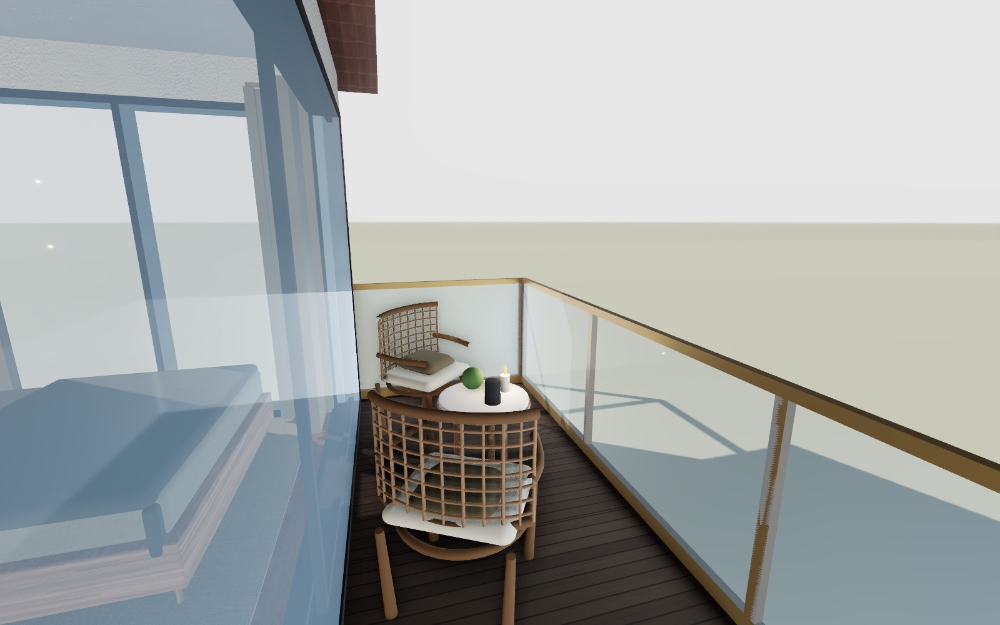<br />
  <sub>Il balcone con il parapetto di vetro, visto dall'interno.</sub>
</div>

### 🎬 Render con Blender, in un comando

Dal pannello **Render** premi **«Esporta per Blender (ZIP)»**: Planify prepara tutta la scena per Cycles, senza nessun lavoro a mano.

<div align="center">
  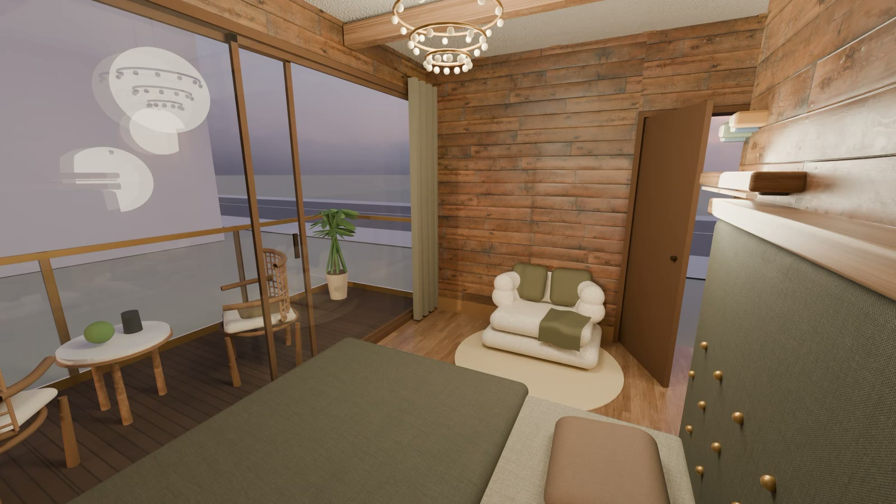<br />
  <sub>Render Cycles in Blender dello stesso progetto, ottenuto con un solo comando da terminale.</sub>
</div>

<br />

<table>
  <tr>
    <td width="50%">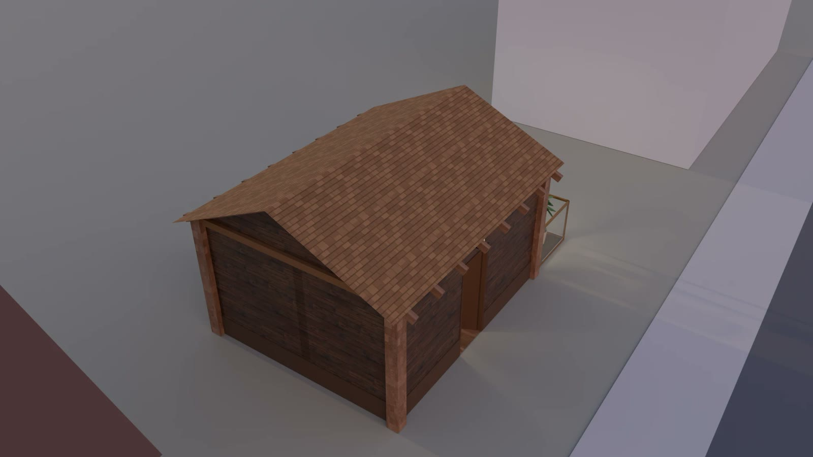<br /><sub><b>Esterno</b> · tetto, travetti, pilastri e luce del tramonto.</sub></td>
    <td width="50%">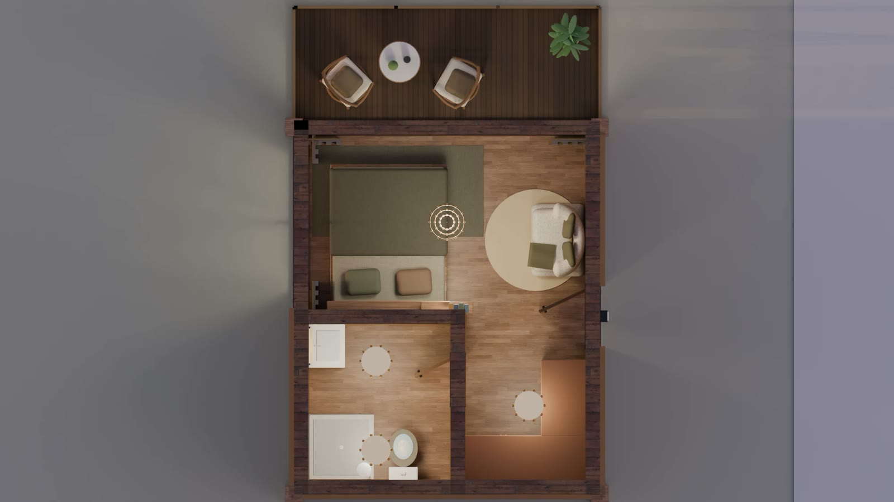<br /><sub><b>Pianta dall'alto</b> · camera ortografica, senza tetto, con i corpi illuminanti accesi.</sub></td>
  </tr>
  <tr>
    <td width="50%">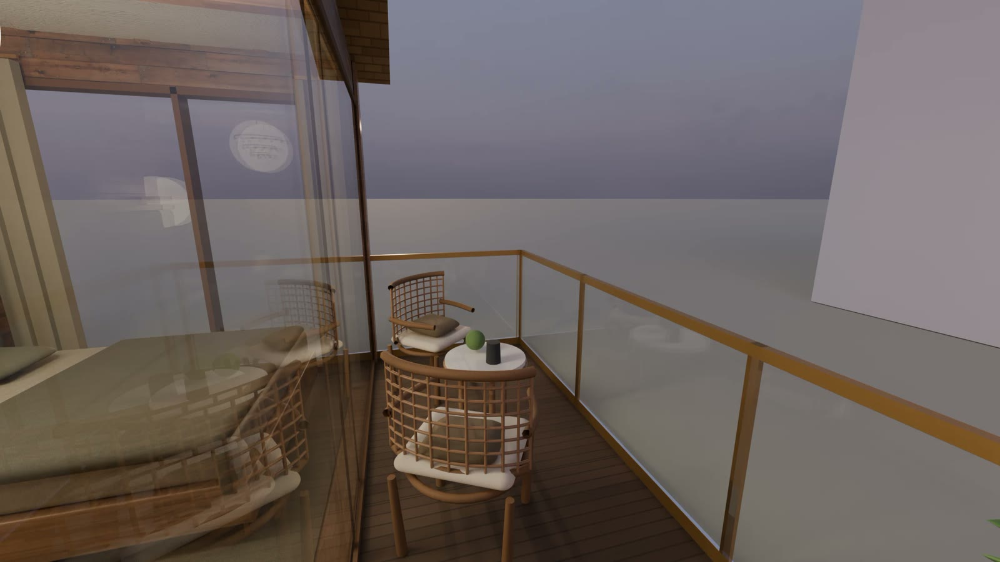<br /><sub><b>Balcone</b> · vetro vero, riflessi e arredi in rattan.</sub></td>
    <td width="50%">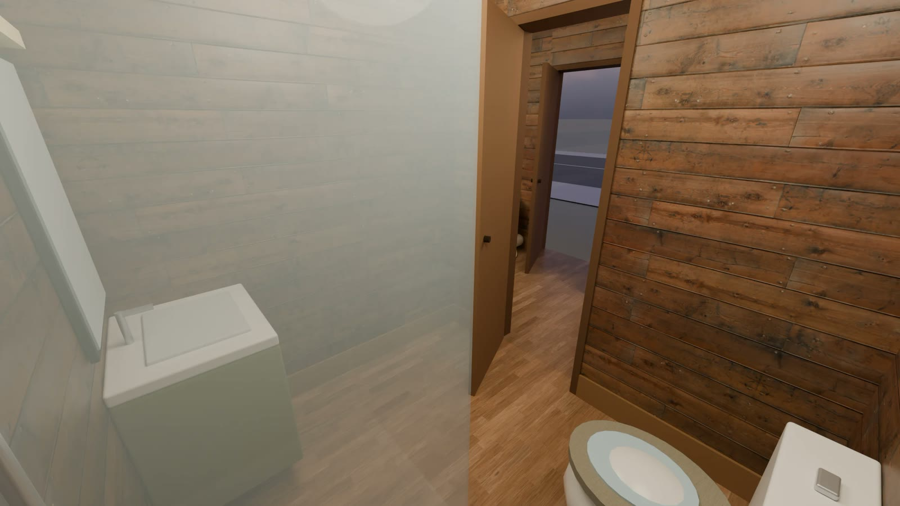<br /><sub><b>Bagno</b> · pareti e pavimento con le texture dello stile.</sub></td>
  </tr>
</table>

**Cosa trovi nello ZIP**

| File | A cosa serve |
|---|---|
| `<nome>.glb` | La casa con tetto, soffitti, finestre e vetri, arredi, sole, punti luce, sensori e le inquadrature come camere. |
| `<nome>_blender.py` | Lo script che prepara Cycles: cielo, sole all'ora scelta, lampade accese o spente, vetro vero, mappa tonale, riduzione del rumore, scheda grafica, camere e risoluzione. |
| `cielo.hdr` | Il cielo dell'ora scelta (Poly Haven, CC0). |
| `RENDER.command` · `RENDER.bat` | Doppio clic: trovano Blender e renderizzano tutte le inquadrature. |

**Da terminale** (Blender 3.6 o successivo, qui con l'app su Mac). Estrai lo ZIP, entra nella cartella e lancia:

```bash
/Applications/Blender.app/Contents/MacOS/Blender -b --python nome-progetto_blender.py -- tutte
```

Blender parte senza interfaccia (`-b`), carica il `.glb`, imposta cielo, sole e luci, e salva un PNG per ogni camera (`CAM_*.png`) accanto allo script. Se `blender` è nel `PATH` basta `blender -b --python nome-progetto_blender.py -- tutte`; senza `tutte` prepara solo la scena. Per cambiare ora del giorno, risoluzione o numero di campioni modifica le prime righe dello script.

### ⚡ Impianti, norme e computo

<table>
  <tr>
    <td width="50%">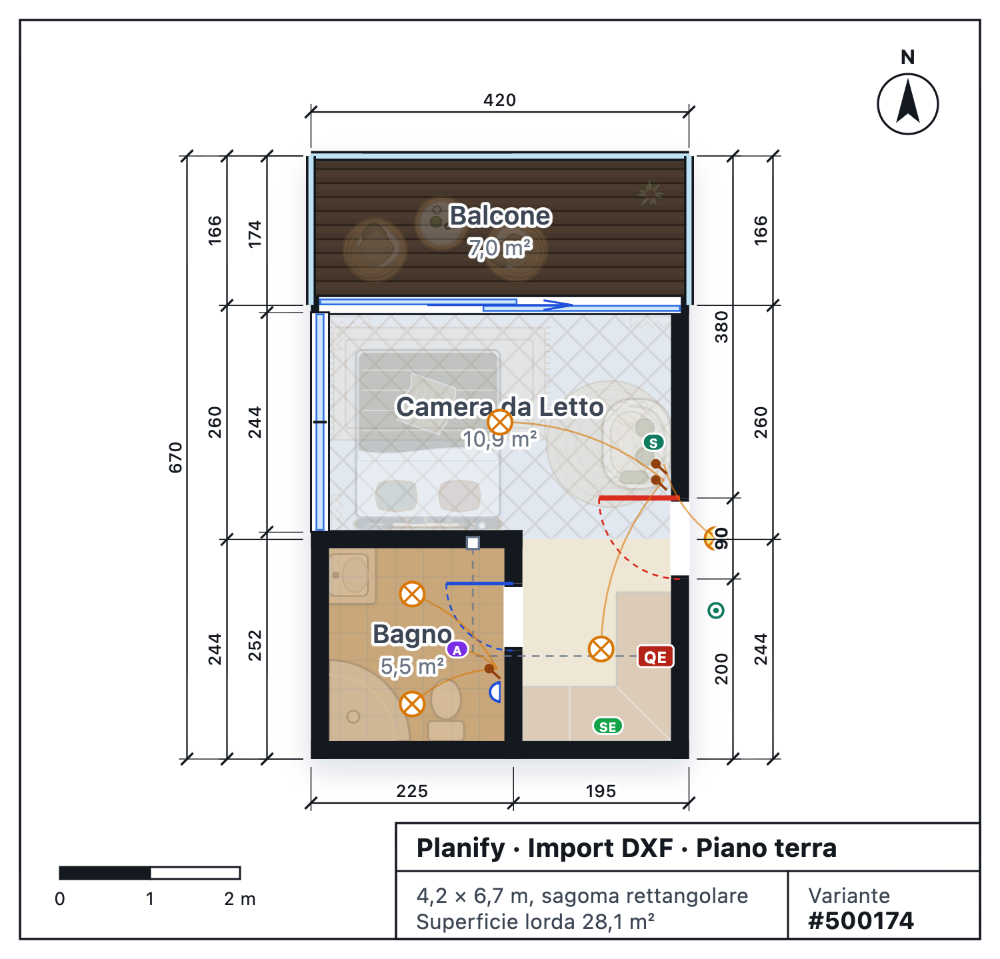</td>
    <td width="50%">
      <ul>
        <li><b>Impianto elettrico</b> secondo i livelli CEI 64-8: punti luce, comandi, prese, circuiti e quadro, con una tavola a parte. I punti luce si <b>trascinano</b> e restano dove li metti, anche in 3D.</li>
        <li><b>Impianto idraulico</b> con tubazioni, scarichi e collettore.</li>
        <li><b>Allarme:</b> sensori e verifica della copertura.</li>
        <li><b>Verifica normativa</b> (rapporti aeroilluminanti, altezze, scale).</li>
        <li><b>Computo e preventivo</b> dei materiali, con una <b>libreria</b> caricabile da CSV.</li>
      </ul>
    </td>
  </tr>
</table>

### 📐 Tavole in scala

<table>
  <tr>
    <td width="60%">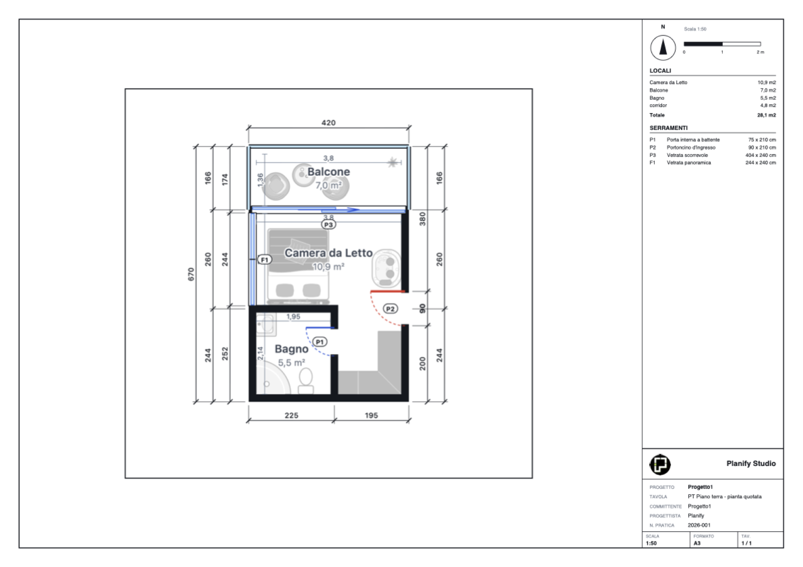</td>
    <td width="40%">
      <ul>
        <li><b>PDF</b> (un foglio per piano) o <b>DXF</b> con cornice e cartiglio, a scala vera (1:50, 1:100…).</li>
        <li><b>Modelli salvabili</b> nel progetto e nel browser: formato, orientamento, margini, cornice, spessore delle linee, bianco e nero, carattere.</li>
        <li><b>Impaginazione:</b> colonna a destra o a sinistra, cartiglio in alto o in basso, nord, elenco dei locali e abaco dei serramenti.</li>
        <li>Cartiglio con studio, committente, progettista, pratica, titolo e note.</li>
      </ul>
    </td>
  </tr>
</table>

### 🔁 Importa, condividi, salva

| | |
|---|---|
| **Importa** | DXF di studio (con scelta dei layer), PDF esportati da un CAD e planimetrie catastali scansionate (riconoscimento con OpenCV). |
| **Esporta** | PNG, SVG, JSON, PDF, DXF, GLB, IFC. |
| **Condividi** | Link di sola lettura: il progetto sta nell'indirizzo e non passa da nessun server. |
| **Salva** | Cronologia nel browser (con la stella un progetto non si cancella mai) e sincronizzazione nel cloud con Supabase. |
| **Privacy** | Banner di consenso; statistiche anonime solo se le accetti. |

---

<a id="come-funziona"></a>

## 🧠 Come funziona

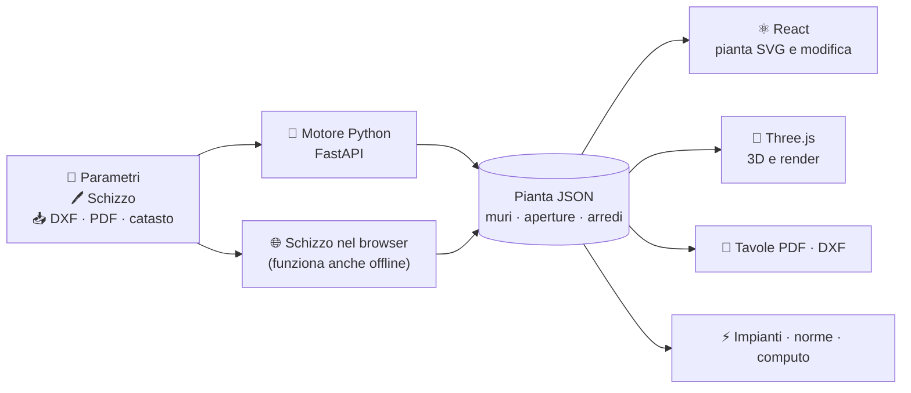

**Il motore (Python).** Una pipeline in cinque passi:

1. **Layout:** divide il lotto in locali secondo la tipologia.
2. **Muri:** li ricava dai confini delle zone.
3. **Porte:** analizza le adiacenze e garantisce che ogni locale sia raggiungibile.
4. **Finestre e vetrate:** sui muri esterni, scegliendo dove una vetrata panoramica ci sta.
5. **Arredi:** una classe `Placer` posiziona letti, divani, cucine, sanitari e decori senza collisioni.

Genera più varianti e ne sceglie una col punteggio di progetto più alto; lo stesso seed dà la stessa pianta.

**L'interfaccia (React).** Disegna la pianta in SVG vettoriale (quote, cartiglio, temi chiaro e scuro), costruisce la scena Three.js dallo stesso JSON, e ricalcola impianti, norme e computo a ogni modifica.

---

<a id="avvio-rapido"></a>

## 🚀 Avvio rapido

Servono Python 3.11+ e Node.js. Backend e interfaccia si avviano separatamente.

**1. Motore (API)**

```bash
pip install -r requirements.txt
uvicorn main:app --reload
```

L'API risponde su `http://localhost:8000` (controllo: `/health`).

**2. Interfaccia**

```bash
cd floorplan-app
npm install
npm run dev
```

Apri `http://localhost:5173` e, in **Connessione**, indica l'indirizzo del motore (oppure imposta `VITE_BACKEND_URL` in un file `.env`). Senza motore il disegno a mano funziona comunque.

**Variabili d'ambiente (facoltative)**

| Variabile | A cosa serve |
|---|---|
| `VITE_BACKEND_URL` | Indirizzo del motore Python. |
| `VITE_SUPABASE_URL` · `VITE_SUPABASE_ANON_KEY` | Accesso e sincronizzazione nel cloud. |

**Docker** · il `Dockerfile` impacchetta il motore e funziona su Hugging Face Spaces e su Render. L'interfaccia è pronta per Vercel (`floorplan-app/vercel.json`).

---

<a id="test"></a>

## 🧪 Test

```bash
# Interfaccia e logica (Node)
cd floorplan-app
for f in tests/*.test.mjs; do node --import ./tests/loader.mjs "$f" || echo "FALLITO $f"; done

# Motore (Python)
python3 tests/test_interior.py        # oppure: python3 -m pytest tests

# Interfaccia nel browser (Playwright)
npm run test:ui
```

---

## 🗂️ Struttura del progetto

```text
planify/
├─ main.py                 API FastAPI
├─ planner.py              motore: layout, muri, porte, finestre, arredi, giardino, garage
├─ dxf_import.py · pdf_import.py · catasto_import.py · curves.py
├─ floorplan-app/          interfaccia React + Vite
│  ├─ src/components/      pianta SVG, editor, pannelli, 3D
│  ├─ src/lib/             scena 3D, render, impianti, tavole, schizzo, esportazioni
│  ├─ tests/               test della logica (Node)
│  └─ e2e/                 test dell'interfaccia (Playwright)
├─ tests/                  test del motore (Python)
├─ docs/                   piani di lavoro e specifiche
│  └─ media/               immagini e video di questo README
└─ supabase/               modelli email e configurazione cloud
```

---

<a id="documentazione"></a>

## 📚 Documentazione

Le specifiche e i piani di lavoro stanno in [`docs/`](docs):

- [Funzioni: nord, sezioni, tetto, touch](docs/PIANO_FUNZIONI.md)
- [Multipiano, scale e giardino](docs/PIANO_MULTIPIANO.md)
- [Stili 3D e materiali](docs/PIANO_STILI_3D.md)
- [Impianti e 3D](docs/PIANO_IMPIANTI_3D.md)
- [Regole da interior designer](docs/PIANO_INTERIOR.md)
- [Normativa](docs/PIANO_NORMATIVA.md)
- [Copertura e allarme](docs/PIANO_COPERTURA.md)

---

<div align="center">
  <sub>Texture PBR di <a href="https://ambientcg.com">ambientCG</a> (CC0) · Icone <a href="https://lucide.dev">Lucide</a> · Fatto con cura per chi progetta casa.</sub>
</div>
